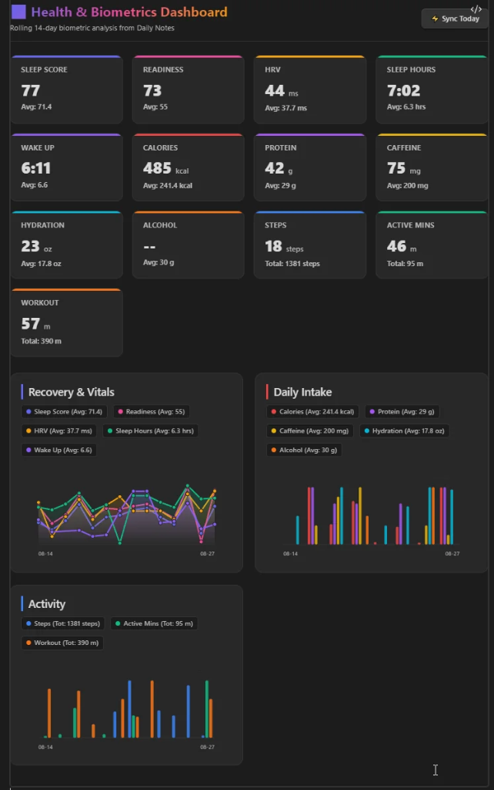

# Health Connect & Biometrics Dashboard for Obsidian

A sleek, privacy-first Obsidian plugin for **Desktop and Mobile (`isDesktopOnly: false`)** that automatically syncs and visualizes **Sleep, HRV, Readiness, Workouts, Hydration, and Nutrition** from **Google Health, Fitbit, Apple Health, or manually logged daily notes** directly into responsive ````health-dashboard```` charts and KPI cards.

[](https://github.com/jare0014/obsidian-health-connect/releases)
[](https://obsidian.md)
[](https://github.com/TfTHacker/obsidian42-brat)
[-purple.svg)](https://obsidian.md/plugins)
[](https://buymeacoffee.com/jare0014)

---



---

## ✨ Features

- **📱 Full Desktop & Mobile Support (`isDesktopOnly: false`)**: Runs natively on Windows, macOS, Linux, iOS, and Android using Obsidian's cross-platform `requestUrl` networking, `vault.adapter` file operations, Keychain `SecretStorage`, and `MobileOAuthModal`.
- **⚡ Automated & Manual Tracking**: Sync biometrics automatically from Google Health, Fitbit, and Apple Health, or chart your own manually tracked habits, mood, and health scores in Daily Notes.
- **📊 Responsive Visual Dashboard**: Embed ````health-dashboard```` anywhere in your vault to render interactive KPI cards, rolling averages, total intake calculations, tooltips, and smooth zero-dependency SVG sparklines, multi-line trends, and grouped bar charts matching your theme.
- **📝 Supported Data Formats**: The dashboard parses data from **YAML frontmatter (`Key: Value`)**, **inline Dataview fields (`Key:: Value`, `- [ ] Key:: Value`)**, and **bullet lists (`- Key: Value`)**.
- **🧮 Custom Calculated Metrics**: Define new metrics using spreadsheet-style mathematical formulas combining existing variables (e.g. `(protein * 4) + (carbs * 4) + (fat * 9)` or `(HRV / 60) * (Sleep_hours / 8) * 100`) with an optional toggle to write results back to your daily note frontmatter.
- **🏋️ Bidirectional Workout Sync & Reconciliation**: Cross-references workout sessions in Obsidian Daily Notes with Google Health API, uploading unrecorded local workouts and merging watch workouts without duplicate entries.
- **🥗 Food & Beverage Quick Logger**: Built-in visual logger with custom servings, presets, and local registry management that posts nutrition records directly to Google Health API and keeps your daily frontmatter synchronized.
- **🔐 Keychain SecretStorage & Privacy-First Architecture**: Direct OAuth 2.0 communication between Obsidian and Google Health APIs / local JSON drops. Stores client secrets and refresh tokens in Obsidian's `SecretStorage` Keychain (keeping `data.json` scrubbed of sensitive credentials when supported) with zero middleman servers or telemetry.
- **🗺️ Fully Configurable Field Mappings**: Map incoming biometrics to any custom YAML frontmatter or inline property names in your vault.

---

## 📱 Desktop & Mobile Architecture (`isDesktopOnly: false`)

Version `1.0.0` is built with 100% cross-platform Obsidian APIs so your dashboards, activity logging, and sync work seamlessly across Desktop and Mobile:

- **Keychain `SecretStorage`**: Client secrets, refresh tokens, and imported OAuth JSON credentials are stored in Obsidian's native `SecretStorage` keychain whenever supported by your Obsidian client, keeping `data.json` free of plaintext credentials when syncing across devices.
- **`MobileOAuthModal` & Desktop-Synced Auth**: Because mobile devices cannot run a local `localhost:8092` loopback server, tapping **Connect Google Account** on iOS or Android opens `MobileOAuthModal`. Sign in via your device browser and paste the redirect URL or `code=` parameter—or tap **Test Synced Token** if your credentials/tokens already sync from Desktop.
- **Cross-Platform `requestUrl` Networking**: All Google OAuth token exchanges, refreshes, and Google Health v4 REST API requests run through Obsidian's native `requestUrl` API without Node `http`/`fetch` constraints.
- **`vault.adapter` Drop Folder & Plugin Config**: Watched JSON drop folder ingestion and optional Meta Bind button registration operate purely through Obsidian's `vault` and `vault.adapter` / `configDir` APIs (no Node `fs` or `path` dependencies).

---

## 🔄 How Syncing Works

This plugin supports flexible syncing pipelines for both **Android/Fitbit** and **Apple Watch/iPhone** ecosystems:

### 1. 🌐 Universal Cloud Sync (Google Health, Health Connect, Fitbit & Apple Watch) — *Recommended*
* **How it works**: Connects directly to the Google Health v4 REST API (`health.googleapis.com`) via `requestUrl` using your own free, personal Google OAuth 2.0 client.
* **📱 Android, Wear OS & Garmin**: Native sync with Pixel Watch, Samsung Galaxy Watch, Fitbit, Garmin (via Garmin Connect → Health Connect), and any wearable connected to Android **Health Connect** / **Google Health**.
* **🍏 iPhone & Apple Watch**: Install the free **Google Fit / Google Health** app on your iPhone and allow it to sync with Apple Health. Your Apple Watch sleep, heart rate, workouts, and steps flow through Google Health straight into Obsidian on both Desktop and Mobile.
* **What it syncs**:
  * **Sleep & Recovery**: Sleep duration (`Sleep_hours`), Sleep Score (`Sleep_score`), Deep Sleep (`Deep_sleep`), Sleep Stages (*Deep, REM, Light, Awake*), Wake-up time (`wake_up`), Bedtime.
  * **Vitals & HRV**: RMSSD Heart Rate Variability (`HRV`), Resting Heart Rate (`resting_heart_rate`), Blood Oxygen (`spo2`), Respiratory Rate (`respiratory_rate`), Skin Temperature.
  * **Activity & Fitness**: Steps (`steps`), Active Zone Minutes (`active_minutes`), Calories Burned (`calories_burned`), Distance, Floors Climbed, and Workouts (`workout`).
  * **Body Measurements**: Weight (`weight`), Body Fat % (`body_fat`), BMI.
  * **Nutrition & Hydration**: Calories (`calories`), Protein (`protein`), Carbs (`carbs`), Fat (`fat`), Hydration (`hydration`), Caffeine (`caffeine`).
* **Bi-directional Workouts & Nutrition**: Built-in visual loggers write workouts and meal entries directly to Google Health API and update your active daily note frontmatter in real time.
* **🧘 Local-First Mindfulness**: Mindfulness minutes (`mindfulness_minutes`) are logged locally to your daily notes via the Health Activity Hub, custom frontmatter properties, or inline daily note logs. Because the Google Health v4 REST API does not support a standalone mindfulness write scope, mindfulness reflection data stays local and private in your vault (while `mindfulness.readonly` remains supported for read scopes).

### 2. 📂 Watched Folder JSON Ingestion (Apple Health, Garmin & Offline Drops) — *Optional Offline Path*
* **How it works**: For privacy-focused users or offline automation who prefer a 100% local workflow without a Google account. Point the plugin to any vault folder (e.g. `00_Imports/Health/`) via Obsidian's `vault.adapter` to watch for exported health JSON files on Desktop or Mobile.
* **Hands-Free Ingestion**: A real-time vault watcher automatically detects incoming JSON files, parses the metrics into your Daily Notes, and safely archives the processed files into an `Archive/` subfolder.

---

## 📦 Installation

### Option 1: Obsidian Community Plugins *(Pending Review)*
`v1.0.0` has been prepared for the official Obsidian Community Plugins directory (currently pending store review):
1. Open **Obsidian Settings > Community plugins** (make sure Restricted mode is turned off).
2. Click **Browse** and search for **`Health Connect & Biometrics Dashboard`**.
3. Click **Install**, then **Enable**.

### Option 2: Install v1.0.0 via BRAT *(Available Now)*
1. Install the **[BRAT (Obsidian42 - BRAT)](https://github.com/TfTHacker/obsidian42-brat)** plugin from Obsidian Community Plugins.
2. In Obsidian Settings, go to **BRAT > Add Beta plugin**.
3. Enter the repository URL (tracks release **`1.0.0`**):
   ```text
   https://github.com/jare0014/obsidian-health-connect
   ```
4. Click **Add Plugin**, then enable **Health Connect & Biometrics Dashboard** under **Installed Plugins**.

---

## 🚀 Quick Setup Guide (Desktop & Mobile)

Connecting your Google Account requires a free personal Google Cloud Project (takes ~3 minutes):

### Part 1: Create GCP Project & Enable Health API
1. Open the [Google Cloud Console](https://console.cloud.google.com/).
2. Click the project dropdown at top-left → **New Project** → Name it `Obsidian-Health` → Click **Create**.
3. Go to **APIs & Services > Library**, search for **Google Health API** (v4 REST API), and click **Enable**.

### Part 2: Configure OAuth Consent Screen & Scopes
1. Go to **APIs & Services > OAuth consent screen**.
2. Select **Audience / User Type: External** → Click **Create / Next**.
3. Enter an App Name (e.g. `Obsidian Health Connect`) and your email for Developer & Support contact.
4. Under **Scopes**, click **Add or Remove Scopes** and enable:
   - `https://www.googleapis.com/auth/googlehealth.sleep.readonly`
   - `https://www.googleapis.com/auth/googlehealth.health_metrics_and_measurements.readonly`
   - `https://www.googleapis.com/auth/googlehealth.activity_and_fitness.readonly`
   - `https://www.googleapis.com/auth/googlehealth.activity_and_fitness.writeonly`
   - `https://www.googleapis.com/auth/googlehealth.nutrition.readonly`
   - `https://www.googleapis.com/auth/googlehealth.nutrition.writeonly`
   - `https://www.googleapis.com/auth/googlehealth.mindfulness.readonly` *(optional read-only scope; mindfulness logging in Obsidian is local-first)*
5. Under **Test users**, click **+ Add Users** and enter your personal Gmail address.  
   *(Tip: Click **Publish App** on the OAuth overview so your refresh token never expires after 7 days)*.

### Part 3: Create OAuth Client ID & Connect
1. Go to **APIs & Services > Credentials** → Click **+ Create Credentials > OAuth client ID**.
2. Application type: **Web application**.
3. Name: `Obsidian Client`.
4. Authorized redirect URIs: `http://localhost:8092`.
5. Click **Create** → Click **Download JSON** (or copy the Client ID and Client Secret).
6. Open **Obsidian Settings > Health Connect & Biometrics Dashboard**, paste the Client ID/Secret or the full downloaded JSON into the box (stored securely in Keychain `SecretStorage` where supported), and click **Connect Google Account**.
7. **On Desktop**: Approve permissions in your browser—the local loopback catches the redirect automatically and switches the badge to `🟢 Connected`.
8. **On Mobile (iOS / Android)**: `MobileOAuthModal` opens automatically—tap **Open Google Sign-In**, approve access, copy the `http://localhost:8092/?code=...` redirect URL (or just the `code=` value) from your browser's address bar, and paste it into the modal to complete authorization. (Or tap **Test Synced Token** if you already authorized on Desktop and sync vault settings.)

---

## 📊 Dashboard Usage

Add this codeblock anywhere in your Daily Notes, Weekly Reviews, or Health Dashboard note:

````markdown
```health-dashboard
```
````

### Custom Date Ranges & Options
You can override rolling windows or filter specific date ranges:

````markdown
```health-dashboard
days: 30
excludeWeekends: true
```
````

Or filter with exact start/end dates:

````markdown
```health-dashboard
from: 2026-08-01
to: 2026-08-19
```
````

---

## 🏥 Health Activity & Registry Hub

- **Quick Modal Access**: Open via ribbon icon 💓, command palette: `Health Connect: Open Health Activity Hub`, or deep link (`obsidian://health-connect?tab=log&category=nutrition` or `obsidian://health-connect-hub`).
- **Three Unified Verbs**:
  - **Add to Log 📝**: Quickly log Food/Drinks, Workouts, Mindfulness sessions, or Sleep stats.
  - **View History 🕒**: Inspect recent Google Health records (food, workouts) and local Daily Note records (mindfulness, sleep) with 1-click **"Pull to Note 📥"** buttons.
  - **Manage Registry ⚙️**: Manage custom food items, workout presets with Google Health API activity type mappings, and mindfulness session presets.
- **Instant Shortcuts**: Direct commands exist for power users who want to jump straight to a specific log (`Quick Log Food & Drink`, `Quick Log Workout`, `Quick Log Mindfulness`, `Quick Log Sleep`).
- **Cloud & Local Persistence**: Posts workouts and nutrition events directly to Google Health v4 REST API, while persisting mindfulness and sleep directly to Daily Note frontmatter.

---

## 🧮 Custom Calculated Metrics & Historical Lookback

Want to create composite health scores, compute macro calories, or track multi-day rolling averages? Use the built-in **Formula Builder** in settings:

- **Spreadsheet-Style Math**: Write standard arithmetic formulas (e.g., `(protein * 4) + (carbs * 4) + (fat * 9)` or `(HRV / 60) * (Sleep_hours / 8) * 100`).
- **Clickable Variable & Function Chips**: Quick-insert detected daily note variables and rolling window functions directly from the formula builder UI.
- **📈 Multi-Day Sliding Lookback Windows**:
  - `rolling_max(variable, days)`: Resolves the maximum value over the preceding $N$ days (e.g. `rolling_max(weight, 30)` or `rolling_max(steps, 14) - steps`).
  - `rolling_min(variable, days)`: Resolves the minimum value over the preceding $N$ days (e.g. `rolling_min(resting_heart_rate, 14)`).
  - `rolling_avg(variable, days)`: Resolves the rolling average over the preceding $N$ days (e.g. `rolling_avg(calories, 7)`).
  - `rolling_sum(variable, days)`: Resolves cumulative sum over the preceding $N$ days (e.g. `rolling_sum(steps, 7)`).
  - Evaluated via Obsidian's in-memory metadata cache across historical daily notes in $< 1$ ms.
- **📐 Nested Math Functions**:
  - `max(a, b, ...)` and `min(a, b, ...)`: Clamping and boundary checks (e.g. `max(0, 10000 - steps)`).
  - `round(x)` or `round(x, decimals)`: Format values with precise decimal rounding (e.g. `round(val, 1)`).
  - `abs(x)`, `floor(x)`, `ceil(x)`, `sqrt(x)`: Standard scalar transforms.
- **🔄 Single-Day Lookback Variables (`_prev`, `_yesterday`, `last_<metric>`)**:
  - Reference yesterday's or previous day's metrics using the `_prev` or `_yesterday` suffix (e.g. `caffeine_prev`, `alcohol_yesterday`, `steps_prev`), or `last_<metric>` aliases such as `last_sleep` (and `last_sleep_hours`).
  - **Automatic Time String Parsing**: Time durations formatted as `"HH:MM"` (e.g. `"7:30"`) are automatically parsed into decimal hours (`7.5`), making cross-day rolling averages or deficit tracking effortless (e.g. `(Sleep_hours + last_sleep) / 2`).
  - **Safe Fallbacks**: Missing optional lookback variables default gracefully to `0` without breaking formula evaluation.
- **Frontmatter Writeback**:
  - *Display Only*: Calculated on the fly when rendering the ````health-dashboard```` codeblock.
  - *Write to Note*: Automatically evaluated and written directly into your daily note frontmatter (e.g. `readiness_score: "85"`) whenever sync runs!

---

## 😴 Sleep Staging & Lookback Window Logic

- **Noon-to-Noon Lookback Window**: Sleep sessions crossing midnight are queried across a 24-hour local noon-to-noon window (`targetDate - 1 12:00` to `targetDate 12:00`). This ensures overnight sleep sessions are attributed accurately to the waking morning date.
- **Staged Biometrics**: The plugin extracts and records total sleep duration (`Sleep_hours`), sleep score (`Sleep_score`), deep sleep duration (`Deep_sleep`), wake-up time (`wake_up`), and resting heart rate / HRV recorded during deep sleep.
- **Multi-Source Sleep Parsing**: Supports Google Health v4 `stagesSummary` (Fitbit, Pixel Watch, Samsung Galaxy Watch) and direct summary properties, handling both decimal hours and `"HH:MM"` notation.

---

## 🛠️ Google Health Posting Diagnostics & Troubleshooting

When logging workouts or nutrition to Google Health, keep the following integration details in mind:

- **OAuth Write Scopes**: Ensure both `https://www.googleapis.com/auth/googlehealth.activity_and_fitness.writeonly` and `https://www.googleapis.com/auth/googlehealth.nutrition.writeonly` are enabled on your Google Cloud OAuth Consent Screen and authorized in settings.
- **Exercise Enum Normalization**: The Google Health v4 REST API strictly requires standard Protobuf activity types (e.g. `CALISTHENICS`, `STRENGTH_TRAINING`, `WALKING`, `RUNNING`, `BIKING`, `YOGA`, `STRETCHING`, `SWIMMING`, `PILATES`, `AEROBIC_WORKOUT`, `OTHER`). Obsidian Health Connect automatically normalizes freeform workout titles and registry entries into compliant types while retaining your rich custom titles locally in Obsidian.
- **Workout Deduplication & Idempotency**:
  - Cloud sessions pulled from Google Health (e.g. generic `"Calisthenics"`, `"Workout"`, or `"Other Workout"`) are intelligently cross-referenced against your local daily note sessions using duration matching (±5m), mapped activity categories, and timestamp intervals.
  - Specific named sessions (e.g. `"Exercises: Phase 1 (11m)"`) take precedence over generic cloud categories, preventing duplicate workout entries in note frontmatter.
  - Previously uploaded local sessions are marked as matched and will not be re-posted on subsequent sync passes.
- **Session Timestamp Constraints**: Google Health API deduplicates or rejects writes that share identical start and end timestamps or overlapping intervals of the same activity type. Ensure sequential workouts have distinct start times or valid duration estimates.

---

## 📂 Watched Folder JSON Ingestion (Apple Health, Garmin & Offline Automation)

If you prefer an offline workflow or automated file drops, the plugin uses Obsidian's `vault.adapter` to monitor a target folder in your vault (e.g. `00_Imports/Health/`) and automatically ingest any structured health JSON files into your daily notes on Desktop or Mobile:

1. In plugin settings, turn on **Enable Watched Folder JSON Ingestion**.
2. Specify your drop folder (e.g. `00_Imports/Health`).
3. Whenever an automated script or shortcut drops a `*.json` file into this folder, the plugin parses the metrics, updates that date's Daily Note frontmatter, and moves the processed file to an `Archive/` subfolder.

<details>
<summary>📱 <b>iOS Shortcut Setup Example (Apple Health)</b></summary>

For Apple Watch and iPhone users who prefer offline file export instead of Google Health cloud sync:
1. In the iOS **Shortcuts app** on your iPhone:
   - Create a Shortcut querying daily samples: *Dietary Protein, Dietary Energy, Steps, Sleep Analysis, HRV, Water*.
   - Combine them into a JSON dictionary:
     ```json
     {
       "date": "2026-08-23",
       "protein": 140,
       "calories": 2200,
       "steps": 10500,
       "hydration": 80,
       "Sleep_hours": 7.8,
       "HRV": 65
     }
     ```
   - Save the file as `Health_YYYY-MM-DD.json` into your synced drop folder (via iCloud Drive, Obsidian Sync, or cloud drive).
   - Set an iOS Automation to run nightly at 11:59 PM.
2. Obsidian will automatically ingest the file on sync and archive it!
</details>

<details>
<summary>🏃 <b>Garmin & Other Wearables</b></summary>

* **Cloud (Recommended)**: Link **Garmin Connect** to **Android Health Connect** in the Garmin Connect mobile app settings. Your Garmin steps, heart rate, sleep, and workouts will flow into Google Health and sync directly to Obsidian with zero manual file exports.
* **Watched Folder**: If using third-party export scripts (e.g., Python scripts or Garmin DB exporters), have them output a JSON file with `date` and biometric key/value pairs to your watched folder.
</details>

---

## 🆓 Free Community Plugin vs. Roadmap / Optional Pro Companion

The core Obsidian plugin (`v1.0.0`) is **100% free and open-source (MIT)** with no paywalls, telemetry, or middleman accounts. An optional native Android companion app is on the roadmap for users who want on-device Android Health Connect SDK features that Google's cloud REST API does not expose:

| Capability | Free Community Plugin (`v1.0.0`) | Planned Pro Companion (Android APK) |
| :--- | :---: | :---: |
| **Desktop & Mobile Obsidian Support** (`isDesktopOnly: false`, `requestUrl`, `vault.adapter`) | ✅ Included | — |
| **Google Health v4 Cloud Sync** (Sleep, HRV, Vitals, Steps, Workouts, Nutrition) | ✅ Included | — |
| **Bidirectional Workout & Nutrition Logging + `health-dashboard` Charts** | ✅ Included | — |
| **Keychain `SecretStorage` & `MobileOAuthModal`** | ✅ Included | — |
| **Offline Watched Folder JSON Ingestion & Local-First Mindfulness / Sleep** | ✅ Included | — |
| **On-Device Health Connect `MindfulnessSessionRecord` & `AlcoholConsumptionRecord` Writeback** | — *(API-restricted)* | 🔜 Planned |
| **Zero-Cloud SAF (Storage Access Framework) Direct Vault Sync** | — | 🔜 Planned |
| **1-Tap Android Home-Screen Logging Widgets** | — | 🔜 Planned |

---

## ⌨️ Command Palette Actions

Open the Obsidian Command Palette (`Ctrl/Cmd + P`) to trigger any of the following actions:

| Command | Description |
| :--- | :--- |
| **`Health Connect: Open Health Activity Hub`** | Opens the unified modal with tabs for Add to Log, View History, and Manage Registry across Nutrition, Workouts, Mindfulness, and Sleep. |
| **`Health Connect: Quick Log Food / Beverage`** | Opens the hub directly into the Nutrition logging tab. |
| **`Health Connect: Quick Log Workout / Exercise`** | Opens the hub directly into the Workout logging tab to post to Google Health and note frontmatter. |
| **`Health Connect: Quick Log Mindfulness / Meditation`** | Opens the hub directly into the Mindfulness logging tab to log to daily note frontmatter. |
| **`Health Connect: Quick Log Sleep Stats`** | Opens the hub directly into the Sleep logging tab to log to daily note frontmatter. |
| **`Health Connect: Sync Active Note / Today's Google Health Biometrics`** | Immediately syncs today's (or the active note's) sleep, HRV, steps, and biometrics into daily note frontmatter. |
| **`Health Connect: Reconcile Workouts with Google Health (Bidirectional)`** | Reconciles daily note frontmatter workouts with Google Health API, uploading unrecorded sessions and merging cloud workouts. |
| **`Health Connect: Connect / Authorize Google Account (OAuth)`** | Starts Desktop loopback OAuth or opens `MobileOAuthModal` on mobile. |
| **`Health Connect: Backfill & Sync Last 14 Days Biometrics`** | Queries the past 14 days from Google Health API and backfills missing historical daily notes. |
| **`Health Connect: Scan & Ingest Apple Health Drop Folder (JSON)`** | Manually scans your configured drop folder for any pending health JSON drops. |

---

## ☕ Support the Project

If this plugin helps you maintain healthy habits and quantified-self insights, consider supporting future development:

[](https://buymeacoffee.com/jare0014)

---

## 📄 License

MIT License © 2026 Alex Jarecki
